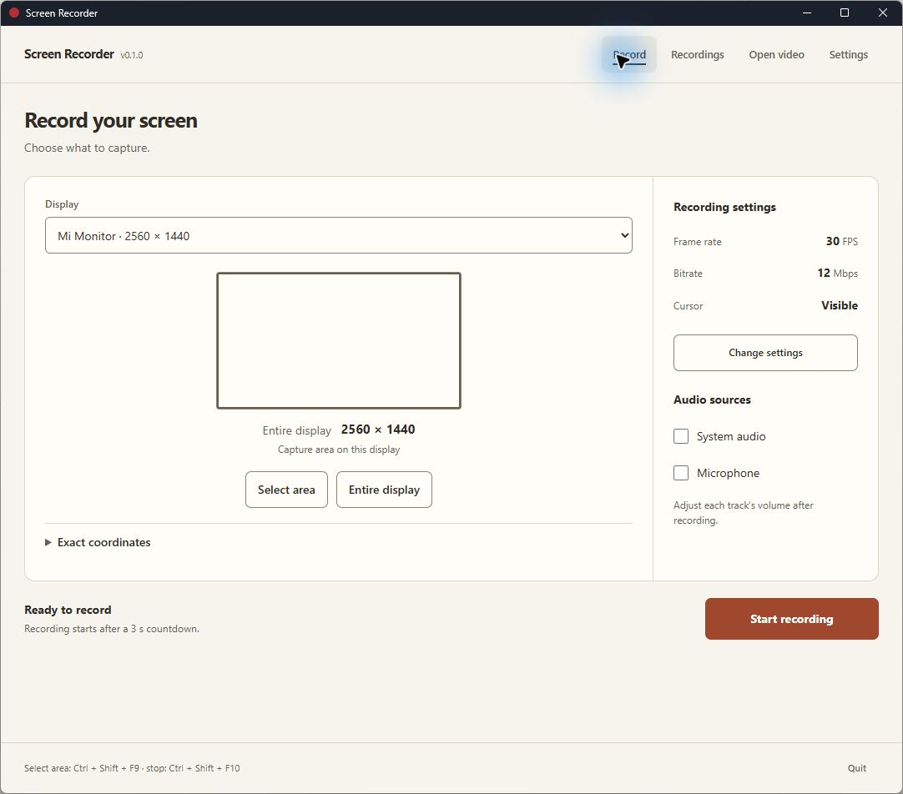
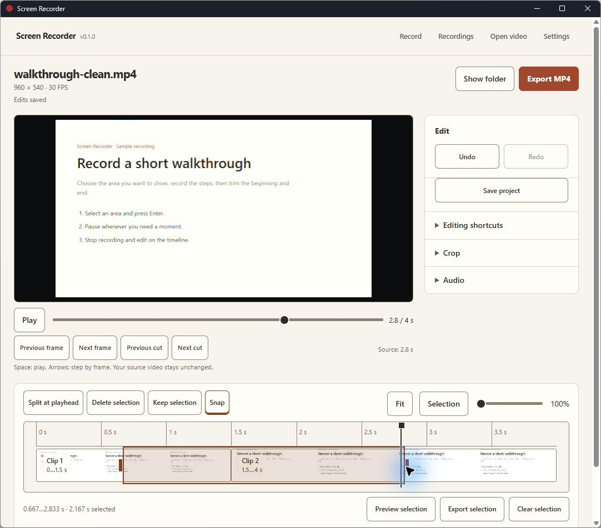

# Screen Recorder

Record a screen area, cut out the parts you do not need, and export an MP4.
A Rust desktop app for Windows and macOS, with a Tauri interface and native capture.

[Download the latest release](https://github.com/datuloar/screen-recorder/releases/latest) · [Usage](docs/USAGE.md) · [Build from source](docs/BUILDING.md)



## Record

Press **Ctrl+Shift+F9**, drag to select an area, then press **Enter**. Recording starts after your configured countdown. Use the floating controls to pause or stop. Closing those controls brings back the main window while recording continues.

- Record at 15, 24, 30 or 60 FPS, with adjustable bitrate and cursor capture.
- Capture system audio and microphone to separate tracks.
- Change global shortcuts by pressing the keys you want to use.
- Browse recent recordings and recover complete fragments after an interrupted session.

## Edit

Drag across the timeline to select a range, then delete it, keep it, preview it or export it separately. Resize the selection by its handles. Split clips at the playhead, snap to cuts, zoom with Ctrl/Command + wheel, and undo changes.

Crop directly over the video and adjust each audio track's volume. Edits save beside the source video; exporting creates a separate file.



## Install

| Package | Requirements |
| --- | --- |
| Windows ZIP | Windows 11 x64, hardware H.264 encoder, Microsoft Edge WebView2 |
| macOS DMG | macOS 14 or later, Apple Silicon or Intel |

On Windows, extract the entire ZIP and run `ScreenRecorder.exe`. Keep the `media` folder beside it. On macOS, drag **Screen Recorder** from the DMG to **Applications**. Screen recording permission is required; enable microphone access if you use it.

This is an early release. Windows capture and editing have been tested locally. macOS builds run in CI, but capture on physical Macs still needs testing. Packages are not signed with a Windows signing certificate or Apple Developer ID; the macOS bundle is ad-hoc signed and is not notarized.

## Development

Rust 1.97.1 is pinned in `rust-toolchain.toml`. Windows builds need MSVC C++ Build Tools and the Windows SDK. macOS builds need Xcode Command Line Tools.

```sh
cargo build --release --locked -p screen-recorder
cargo test --workspace --locked
```

Preview and export use bundled FFmpeg and FFprobe. See [BUILDING.md](docs/BUILDING.md) for their pinned source build and packaging commands.

Every push to `main` starts checks and release builds. The first release uses the Cargo version. Subsequent pushes automatically increment the patch version unless you set a higher version yourself. Both platform packages must succeed before the workflow publishes the release. Release notes group commit messages and include SHA-256 checksums.

[Architecture](docs/ARCHITECTURE.md) · [Design](docs/DESIGN.md) · [Performance measurement](docs/PERFORMANCE.md)

## License

MIT. Release packages include dependency notices, license texts and the FFmpeg source archive. See [THIRDPARTY-NOTICES.md](THIRDPARTY-NOTICES.md).
